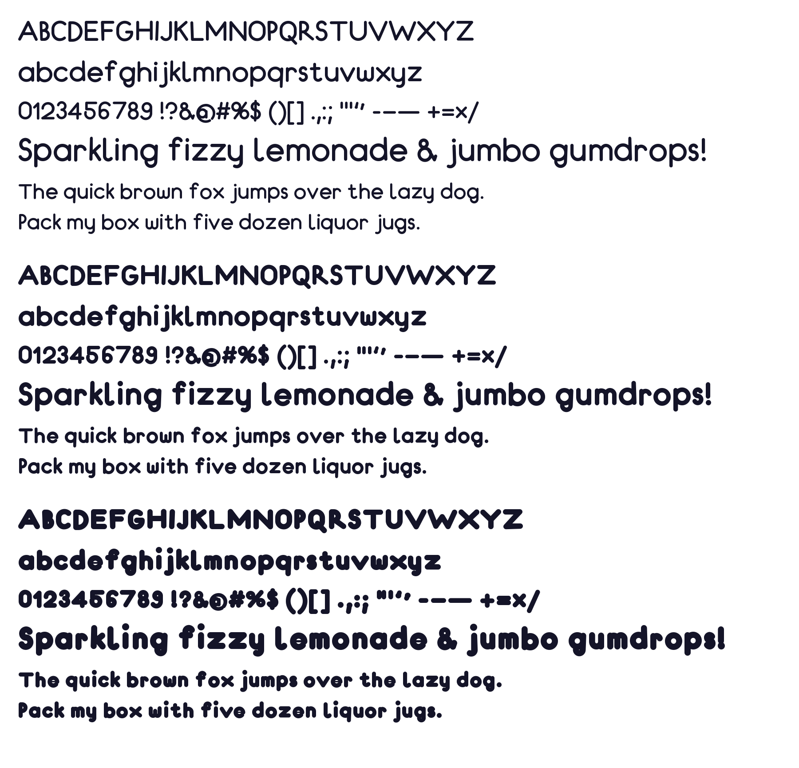

# Fizzpop

Fizzpop is an original display typeface in the bubbly, rounded, bouncy
genre: chunky monoline strokes, round terminals, a big x-height and a gentle
per-letter bounce. It ships in three weights (Light, Regular, Bold) as OTF,
TTF and WOFF2.



## How it is made

Every glyph is drawn once as a **stroke skeleton** of straight lines and
circular arcs (`tools/glyphs.py`). The engine in `tools/stroke.py` expands
the skeleton to an outline with round ends and merges the pieces with a
boolean union, so the same drawing produces every weight: only the stroke
width changes.

* Line and arc offsets are exact (parallel lines, concentric arcs), so the
  outlines are clean cubic curves rather than flattened polygons.
* Radii are expressed as *outer* radii minus the half stroke, so the
  silhouette stays constant across weights while counters shrink.
* Each glyph gets a deterministic small rotation and vertical shift
  (`BOUNCE_TABLE`), applied at skeleton level so arcs stay circular.
* Strokes that would be too thick for a counter (the bar of `e`, the inner
  loop of `@`) scale their own thickness down at heavy weights.

## Build

```sh
python -m venv .venv && . .venv/bin/activate
pip install -r requirements.txt
python tools/build.py            # UFO masters -> fonts/*.otf|ttf|woff2 + specimen
python tools/build.py --no-compile   # only regenerate build/masters/*.ufo
```

Outputs go to `fonts/`; intermediate UFO masters go to `build/masters/`.
Open `specimen/index.html` in a browser for a live specimen.

## Metrics

| | units |
|---|---|
| UPM | 1000 |
| x-height | 520 |
| cap height | 700 |
| ascender | 740 |
| descender | -210 |
| stroke width | Light 100, Regular 140, Bold 190 |

## Character set

Basic Latin (A–Z, a–z, 0–9), common punctuation and symbols, curly quotes,
en/em dash, multiply, minus, inverted ! and ?. A handful of kerning pairs
for the diagonal capitals live in the generated `kern` feature.

## Licence

Not yet decided; the copyright line in the fonts names "The Fizzpop Project
Authors". Pick a licence (for example the SIL Open Font License) before
distributing.
